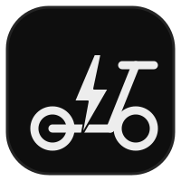
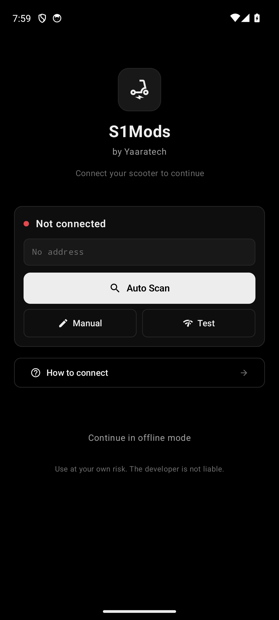
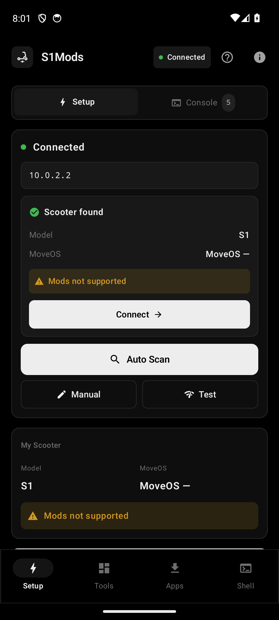

<div align="center">



# S1Mods

### Open-Source Infotainment Utility for Ola MoveOS

*Safe, reversible, one-click modding for the Ola S1 head unit — no flashing, no soldering.*

</div>

[-green.svg)](#supported-vehicles--compatibility-matrix)
[](#technical-specifications)
[](#key-features)
[](#technical-specifications)
[](#safety-reversibility--zero-flash-modification)
[](LICENSE)

An automated, one-click open-source setup utility and standalone Android application to unlock wireless ADB, configure **Floating Touch Navigation (Back, Home, Settings)** and **Music Player** on MoveOS-powered infotainment units running **MoveOS 4.0.5 and above**.

Zero soldering, zero flash partition writes. The only persistent change (the `scootermode`
property ADB needs) is captured and restored by `setup.py --revert`; a reboot clears the
in-RAM ADB key. See **[docs/SAFETY.md](docs/SAFETY.md)** for the full MoveOS / OTA-safe design.

---

## 📱 The app, connected and not connected

The companion app works offline and lights up vehicle actions once a scooter is reachable.
Full walkthrough: **[docs/ECOSYSTEM.md](docs/ECOSYSTEM.md)**.

| 🔴 Not connected | 🟢 Connected |
| --- | --- |
|  |  |
| Discover (**Auto Scan** / **Manual**), or continue offline. | **Scooter found** — install mods and manage the head unit. |

---

## 📋 Full setup guide (Ola S1 / S1 Pro / S1 Air / S1X)

> **Before you start**
> - Works on an Ola S1 head unit running **MoveOS 4.0.5 or newer** (the head unit is Android under the hood).
> - Park the scooter, put the **side stand UP** (lowering it triggers MoveOS auto-lock), and keep the **display awake** during setup.
> - Everything is reversible and never writes the system partition — see **[docs/SAFETY.md](docs/SAFETY.md)**.

### Option A — Phone only, no PC *(recommended)*

**1. Put the phone and scooter on the same network.**
   - On your **Android phone**, turn on **Personal Hotspot**.
   - On the **scooter display**: **Settings → Wi‑Fi → connect to your phone's hotspot**.
   *(Any shared Wi‑Fi works too, as long as both devices are on it.)*

**2. Install the S1Mods app on your phone.**
   - Download **[`S1Mods-v1.1.1.apk`](https://github.com/astechtic/ola-s1-mods/releases/latest)** from the latest release (or the copy in this repo), then open it to install.
   - Allow installing from unknown sources if your phone asks.

**3. Connect to the scooter.**
   - Open **S1Mods** → grant the **Location / Nearby‑devices** permission (Android requires it to find the scooter on the network).
   - Tap **Auto Scan**. When it finds the scooter the status pill turns **🟢 Connected** and shows your model + MoveOS version.
   - If auto‑scan is blocked by your phone, tap **Manual** and paste the scooter's **IP or MAC** (find it on the scooter under **Settings → Wi‑Fi → (your network)**, or on your phone under **Hotspot → Connected devices**).

**4. Install the mods.**
   - Go to the **Setup** tab → **Install Mod** for the 1‑click flow (detect → in‑RAM ADB unlock → install → grant permissions → return to dashboard), **or**
   - Go to the **Apps** tab (App Manager) and tap **Install** on each mod you want (Balls, Music Mod, Android Auto, OpenPlay).

**5. Use them.** The mods appear on the scooter's app list. Tap the floating **Balls** button for Back / Home / Settings; open **Music Mod**, **OpenPlay**, or **Android Auto** from the dashboard.

### Option B — From a computer (Windows / macOS / Linux)

```bash
# same network + side stand up + screen awake, then:
python setup.py                 # discover → unlock ADB → install mods → grant
python setup.py --uninstall     # cleanly remove every mod (reverts grants first)
python setup.py --revert        # restore stock MoveOS state before an OTA / handover
```
Windows users can double‑click **`setup.bat`**. macOS/Linux users can run **`./setup.sh`**. The tool needs `adb` (Android platform‑tools) on PATH; it installs its one Python dependency itself.

### Managing & removing

| Goal | Phone app | PC |
| --- | --- | --- |
| Uninstall a mod (reverts its permissions first) | App Manager → **Uninstall** | `python setup.py --uninstall [pkg…]` |
| Restore stock state **before an Ola OTA** | — | `python setup.py --revert`, then reboot the scooter |
| Fully revert | Uninstall all mods | `python setup.py --uninstall --revert`, then reboot |

Uninstalling is symmetric with install (it undoes exactly what install did), and the tool **refuses to touch MoveOS / system apps**, so it can't break the scooter or its updates. A reboot clears the in‑RAM ADB key on its own.

> **Tip (v1.1.0+):** the phone app's **Health** tab shows each mod's status (installed? granted? up to date?) with one‑tap **Repair**, lets you **back up / restore** your mod state, and warns you if a MoveOS update wiped your mods — with a one‑tap re‑apply. See **[docs/ECOSYSTEM.md](docs/ECOSYSTEM.md)**.

---

## 🎥 Video Demonstration (Ola S1 Pro Gen 2)

Watch the modded infotainment interface and floating touch navigation running live on an **Ola S1 Pro (Gen 2)** with MoveOS:

[▶️ **Click here to watch / download the Demonstration Video (`demo.mp4`)**](demo.mp4)

<video src="demo.mp4" controls="controls" width="100%" style="max-height: 520px;">
  <p>Your browser does not support the video tag. You can <a href="demo.mp4">download or view the video directly here</a>.</p>
</video>

> [!NOTE]
> **Notice on Siri / iOS Voice Unlock in the Video:**
> The Siri Shortcuts / iOS voice unlocking feature demonstrated in the video is **private** and not part of this public release, as it relies on personal account credentials and private session keys. You can unlock your vehicle normally using the official companion app, the touchscreen passkey on the dashboard, or through standard wireless ADB / gRPC commands.

---

## ✨ Key Features

* 📲 **All-in-One Android App (`S1Mods`):** Complete standalone Android application to auto-detect your scooter over a phone hotspot, unlock ADB, install bundled mod APKs, capture screenshots, and open settings directly from your phone — **zero PC required!** Located in [`android/`](android/) and pre-compiled as [`S1Mods-v1.1.1.apk`](S1Mods-v1.1.1.apk).
* 🔍 **Zero-Config Auto-Discovery & Hotspot Helper:** Automatically scans IPv6 link-local multicast and local hotspot subnets. Includes an instant MAC-to-IPv6 converter using SLAAC EUI-64 standards.
* 🛡️ **Zero Power-Manager Tampering (Safe Auto-Lock):** Does **NOT** alter the system power manager or force persistent stay-on. Your scooter's built-in auto-lock and anti-theft security remain 100% untouched.
* 🔓 **Safe & Reversible In-Memory ADB Unlock:** Authorizes ADB over TCP port 5555 using a temporary RAM bind-mount (`mount --bind`). No system, vendor, or boot partitions are ever modified.
* 📱 **Floating Touch Navigation Controls:** Installs **Balls** to provide essential touch buttons (Back, Home, Settings) directly on the infotainment display.
* 🎵 **Offline & Streaming Music Player:** Installs **Music Mod**, giving you ad-free music playback directly from the dash.
* 📦 **Pre-Bundled Local APKs:** Modded application packages live in [`apks/`](apks/) (`balls-1.1.0-lite-release.apk`, `musicmod-release.apk`, `com.yaaratech.androidauto.apk`) with an [`apks/manifest.json`](apks/manifest.json) recording each package, version, SHA-256, upstream and license — for instant, offline, integrity-checked installation. Their source is rebuilt from upstream under [`mods/`](mods/).
* 🛠️ **Automated Permission Grants:** Grants `SYSTEM_ALERT_WINDOW` (overlay), `WRITE_SETTINGS`, and Android Accessibility Services via ADB without manual prompt tapping.
* 🩺 **Mod Health & Management Center (`Health` tab, v1.1.0+):** Per‑mod status at a glance — installed?, version vs. the latest shipped build, and whether each mod's accessibility service + overlay/appops are actually in effect — with one‑tap **Repair** (re‑applies the grant contract), **Install & grant**, and symmetric **Remove**. Also includes **Profiles** (Minimal / Commute / Media / Everything one‑tap bundles), **Backup & restore** of the mod state + `scootermode`, and an **OTA‑safe watchdog** that detects mods a MoveOS update wiped and re‑applies them from your last backup.
* 🔁 **Connection Resilience:** Remembers your last scooter (IP/scope) and silently reconnects on launch, so Auto‑Scan isn't needed every time.
* 🎯 **1-Click Execution:** Run via Android App or double-click `setup.bat` on PC.
* 🐍 **Direct Root Controller (`ola.py`):** Includes a standalone, weakly-typed gRPC root control script to inspect vehicle properties, open settings, take screenshots, or execute root shell commands.

---

## 📱 Supported Vehicles & Compatibility Matrix

> [!IMPORTANT]
> **MoveOS Firmware Requirement:** S1Mods is officially supported **only on MoveOS 4.0.5 and above** (including MoveOS 4.0.5+ and MoveOS 5.x). Older firmware versions (MoveOS 1.x, 2.x, 3.x, and MoveOS 4 builds below 4.0.5) are **not supported**.

> [!NOTE]
> **Display Requirement:** S1Mods requires an **Android-based 7" touchscreen head unit** with Wi-Fi connectivity. Only Ola models equipped with the 7-inch Android infotainment display are compatible.

### ✅ Supported Vehicles (7" Android Touchscreen Models)

| Vehicle Model | Display Screen | Head Unit SoC | MoveOS Version | Status |
| :--- | :--- | :--- | :--- | :--- |
| **Ola S1 Pro (Gen 2)** | 7.0" TFT Touchscreen (800x480 / 720p) | Qualcomm Snapdragon 625 (`msm8953`, 3GB RAM) | MoveOS ≥ 4.0.5 (4.0.5+ / 5.x) | ✅ **100% Tested & Verified** |
| **Ola S1 Pro (Gen 1)** | 7.0" TFT 720p Touchscreen (1280x768) | Qualcomm Snapdragon 212 (`APQ8009`, 3GB RAM) | MoveOS ≥ 4.0.5 (4.0.5+ / 5.x) | 🟢 **Supported (Compatible)** |
| **Ola S1 (Gen 1)** | 7.0" TFT 720p Touchscreen (1280x768) | Qualcomm Snapdragon 212 (`APQ8009`, 3GB RAM) | MoveOS ≥ 4.0.5 (4.0.5+ / 5.x) | 🟢 **Supported (Compatible)** |
| **Ola S1 Air** | 7.0" TFT Touchscreen (800x480) | Octa-Core Processor (3GB RAM) | MoveOS ≥ 4.0.5 (4.0.5+ / 5.x) | 🟢 **Supported (Compatible)** |

### 🎛️ MoveOS Firmware Compatibility Breakdown

| MoveOS Release | Compatibility | Notes |
| :--- | :--- | :--- |
| **MoveOS 5.x** | ✅ **Fully Supported** | Verified with in-memory ADB unlock, Floating Touch Navigation (Balls), Music Mod, and projection. |
| **MoveOS 4.0.5+** (4.0.5, 4.1.x, etc.) | ✅ **Fully Supported** | Baseline supported firmware version for all S1Mods features. |
| **MoveOS 4.0.0 – 4.0.4** | ❌ **Not Supported** | Early MoveOS 4 builds lack required diagnostics/overlay stability. Update your scooter to MoveOS 4.0.5 or above. |
| **MoveOS 2.x & 3.x** | ❌ **Not Supported** | Legacy firmware interfaces and older partition layouts are incompatible. |

### ❌ Incompatible Vehicles (Segmented LCD / Non-Android Models)

The budget **Ola S1 X** series uses a conventional non-touch digital instrument cluster running on a basic microcontroller (MCU/RTOS) without an Android head unit, Wi-Fi hardware, or ADB capability:

| Incompatible Model | Display Hardware | Reason for Incompatibility |
| :--- | :--- | :--- |
| **Ola S1 X (2 kWh / 3 kWh / 4 kWh)** | 4.3" / 3.5" Segmented LCD (Non-Touch) | Microcontroller-based instrument cluster. No Android OS, no Wi-Fi, no APK support. |
| **Ola S1 X+** | 5.0" Segmented LCD (Non-Touch) | Non-touch monochrome LCD panel operated via handlebar buttons. No Android head unit. |

---

## 📋 Technical Specifications

> Verified live on **Ola S1 Pro (Gen 2)** running MoveOS (4.0.5+) on Android 10 (Snapdragon 625).

| Component / Layer | Specification | Technical Details |
| :--- | :--- | :--- |
| **Target Vehicle** | Ola S1 Pro (Gen 2) | 7" Touchscreen Infotainment Unit (A/B Partitioning) |
| **Head Unit OS** | Android 10 (API Level 29) | AOSP Build `QKQ1.191008.001` (MoveOS) |
| **Processor (SoC)** | Qualcomm Snapdragon 625 (`msm8953`) | Octa-Core ARM Cortex-A53 @ 2.0 GHz (64-bit) |
| **Primary ABI** | `arm64-v8a` (64-bit) | Native 64-bit userland (compatible with `armeabi-v7a`) |
| **Graphics (GPU)** | Qualcomm Adreno 506 | Hardware acceleration for native Kanzi HMI dashboard |
| **Diagnostics Service** | Diagnostics gRPC Daemon | Weakly-typed root (`uid 0`) execution on TCP port `50005` |
| **Network Interface** | IPv6 Link-Local (`fe80::/64`) | Discovered via Wi-Fi `ff02::1` multicast ICMPv6 probing / Hotspot |
| **ADB Auth Target** | `/data/misc/adb/adbkeymoveos3_pub_prod` | In-memory bind-mounted from `/data/local/tmp/adb_keys_mine` |
| **Subsystem Safety** | HMI Infotainment Layer Only | Powertrain, BMS, and MCU remain physically & logically isolated |

---

## 🛠️ Direct Head Unit Control (`ola.py`)

The included `ola.py` script communicates directly with the scooter's root gRPC service on port 50005 without requiring pairing or ADB:

```bash
# Display scooter hardware & firmware details
python ola.py info --ipv6 fe80::1234:5678:9abc:def0%22

# Launch native Android Settings menu (Wi-Fi, Bluetooth, Apps, Display, etc.)
python ola.py settings --ipv6 fe80::1234:5678:9abc:def0%22

# Open specific settings panel
python ola.py wifi --ipv6 fe80::1234:5678:9abc:def0%22
python ola.py bluetooth --ipv6 fe80::1234:5678:9abc:def0%22

# Capture head-unit screenshot to PC
python ola.py screenshot dash.png --ipv6 fe80::1234:5678:9abc:def0%22

# Execute arbitrary root shell commands
python ola.py shell "ls -la /data/local/tmp" --ipv6 fe80::1234:5678:9abc:def0%22

# Interactive root shell session
python ola.py interactive --ipv6 fe80::1234:5678:9abc:def0%22
```

---

## 🔒 Safety, Reversibility & Zero Flash Modification

> **Designed to be non‑destructive, reversible, and scoped to your own vehicle.** Full details,
> including the MoveOS/OTA‑compatibility analysis, are in **[docs/SAFETY.md](docs/SAFETY.md)**;
> the warranty question (with Ola's exact T&C wording and sources) is in **[docs/WARRANTY.md](docs/WARRANTY.md)**.

* **Zero partition writes.** No system, vendor, boot, or recovery partitions are touched or flashed. Everything lives in `/data` (user apps) or volatile RAM.
* **In‑memory ADB unlock.** The ADB key is authorized via a RAM `mount --bind` of a key in `/data/local/tmp`. **A reboot clears it and ADB re‑locks** — nothing persists into an OTA.
* **Exactly one persistent change, and it's reversible.** The only thing that survives a reboot is the `persist.ola.security.scootermode` property ADB needs. The tool **captures its stock value before changing it** (on the phone *and* the PC) so it can be restored exactly.
* **One‑tap revert.** Restore the stock state from the phone — **S1Mods → Health → Restore stock state (safe for OTA)** — or from a PC with `python setup.py --revert`, then reboot. Use it before an Ola OTA or handover.
* **Hard guardrail on removals.** Every destructive package action **refuses MoveOS / Ola / Android system packages** (`com.olaelectric*`, `com.ola.*`, `android`, `com.android.*`, `com.google.android.*`, `com.qualcomm.*`, …). A typo can't remove a vehicle app or break the OTA pipeline. *(Covered by tests.)*
* **Integrity before install.** Every APK is verified against its **SHA‑256** in [`apks/manifest.json`](apks/manifest.json) before install (both the PC tool and the in‑app downloader); a mismatch refuses the install.
* **Merge‑safe accessibility.** Enabling Balls' accessibility service never clobbers an existing one — it appends/removes only its own entry.
* **No power‑manager tampering.** The scooter's built‑in auto‑lock and anti‑theft stay 100% intact; the tool only wakes the screen, never forces a persistent stay‑on.
* **Subsystem isolation.** Communication is **exclusively with the Android infotainment unit (HMI)**. It has no access to the powertrain, throttle, BMS, or motor controllers.

| Change | Persists a reboot? | How it's undone |
| --- | --- | --- |
| ADB key RAM bind‑mount | **No** | Reboot (auto), or revert removes the key file |
| `scootermode` property | Yes | Phone **Health → Restore stock state**, or `setup.py --revert` (restores captured stock value) |
| Installed mod APKs | Yes (like any app) | Phone **Health → Remove**, or `setup.py --uninstall` (reverts grants first) |
| Mod appops / permissions / accessibility | Yes | Reverted automatically on uninstall |

---

## 📁 Repository Structure

```
ola-s1-mods/
├── android/               # S1Mods standalone Android application (source)
├── mods/                  # Open-source companion apps, built from upstream forks
│   ├── balls/             #   QuickBall fork       (GPL-3.0-or-later)
│   ├── music/             #   Square fork          (GPL-3.0-or-later)
│   ├── androidauto/       #   open-headunit fork   (AGPL-3.0)
│   └── openplay/          #   DiPlay fork          (GPL-3.0)
├── apks/                  # Mod APKs (single source of truth) + manifest.json
├── docs/                  # BUILD and other guides
├── LICENSES/              # Canonical GPL-3.0 / AGPL-3.0 texts + license matrix
├── ola.py                 # Pure Python gRPC root communication engine
├── setup.py               # Automated discovery, unlock, verify & install engine
├── setup.bat / setup.sh   # 1-click launchers (Windows / macOS-Linux)
├── requirements.txt       # Python dependencies (grpcio)
├── test_ola.py            # Protocol/address unit checks
├── CHANGELOG.md
├── THIRD_PARTY_NOTICES.md # Upstream attribution for the four forks
├── LICENSE                # MIT (covers android/ and the Python tooling only)
└── .gitignore
```

> **Licensing:** S1Mods is a **multi-license** repo. The MIT `LICENSE` covers only the
> S1Mods app and tooling; each app under `mods/` keeps its upstream (A)GPL license. See
> [`THIRD_PARTY_NOTICES.md`](THIRD_PARTY_NOTICES.md) and [`LICENSES/`](LICENSES/).

---

## 👨‍💻 Author & Contact

* **Astechtic ([@astechtic](https://github.com/astechtic))** — Network discovery, device connection workflow, Android app architecture, and project packaging.
  - 🌐 **GitHub:** [@astechtic](https://github.com/astechtic)
  - 💼 **LinkedIn:** [Astechtic](https://www.linkedin.com/company/astechtic)

### 🤝 Acknowledgments & Credits

* **Dev Vikram Singh ([@itsmobsys](https://github.com/itsmobsys))** — Core reverse-engineering research on the Ola S1 `wifican` diagnostics gRPC protocol, the `scootermode`/ADB-key unlock technique, and the original `ola.py` in the [`ola-s1-rea`](https://github.com/itsmobsys/ola-s1-rea) project.
* **Special thanks — Axiom ([pitzel/axiom](https://codeberg.org/pitzel/axiom), Apache-2.0)** 🤝 — for its open diagnostic, CAN telemetry and fault-detection research on Ola scooters.
* **Chayan Mistry** — [Quick Ball](https://github.com/chayanforyou/QuickBall), the floating touch navigation overlay the Balls mod is based on.
* **Lelonio** — [Square](https://github.com/Lelonio/Square), the open-source music player the bundled Music Mod is a fork of.
* **shihabal3amri** — [DiPlay](https://github.com/shihabal3amri/DiPlay), the open-source projection app that OpenPlay is a fork of.
* The open-source Android and automotive reverse engineering community.

> Each bundled or downloadable app (Balls, Music Mod, Android Auto, OpenPlay) is distributed under the license of its upstream project, with its `LICENSE`/`NOTICE` preserved. *"CarPlay"* is a trademark of Apple Inc.; *"Android Auto"* of Google LLC — used only to describe compatibility, with no affiliation.

---

## ⚖️ Legal Disclaimer & Fair Use Notice

> [!IMPORTANT]
> **LEGAL DISCLAIMER & TRADEMARK NOTICE:**
> This repository and application are an independent, non-commercial, open-source educational utility developed by independent software enthusiasts. This project is **NOT** affiliated, associated, authorized, endorsed by, or in any way officially connected with **Ola Electric Mobility Ltd.**, **ANI Technologies Pvt. Ltd.**, or any of their subsidiaries or affiliates.
> 
> *"Ola"*, *"Ola Electric"* and *"MoveOS"* are trademarks of Ola Electric Mobility Ltd. *"S1"*, *"S1 Pro"* and other model names are product designations used only descriptively to indicate compatibility — no claim of trademark ownership is made over them by Ola or by this project. Any reference to these names within this repository, documentation, or application is strictly descriptive and nominative fair use (in accordance with Section 30 of the Indian Trade Marks Act, 1999).
> 
> The developers assume no liability for the use or misuse of this software. Use at your own discretion.

* **Lawful Interoperability:** Research and development are carried out under lawful interoperability doctrines, specifically **Section 52(1)(ab) of the Indian Copyright Act, 1957**, which explicitly permits the reverse engineering and adaptation of computer programs to achieve interoperability with other programs or devices, and international Fair Use principles.
* **Safety & Powertrain Non-Interference:** At no point does this software modify, reflash, or compromise safety-critical vehicle components such as the Motor Controller Unit (MCU), Battery Management System (BMS), accelerator/throttle mapping, or braking subsystems. All interactions are confined strictly to the userland Android infotainment head unit.
* **No Cloud or Backend Interference:** No remote servers, telematics infrastructure, cellular eSIM services, or subscription backends are accessed, compromised, or disrupted. The app talks only to the scooter on the local network and does not use any Ola account, cloud credential, or private signing key.
* **Owner's Own Device:** All operations run against a device the user owns and physically controls, over its own local network, at the owner's initiative. Any vehicle data shown (VIN, registration, telemetry) is read from the owner's own scooter for their own use.
* **Distribution:** This app is **not** published on the Google Play Store. It is released only as an APK on GitHub for owners who choose to sideload it.
* **Warranty:** Modifying the head unit **may affect your Ola warranty** — specifically Ola's exclusion of *"Control Units or software used in vehicle which are not designed or approved by the company"* (Battery Warranty T&C 6.8). It is a practical risk at Ola's discretion; the tool is fully reversible, so restore stock state before any service visit or OTA. Grounded analysis with Ola's exact wording and sources: **[docs/WARRANTY.md](docs/WARRANTY.md)**.

---

## 📄 License

This software is released under the [MIT License](LICENSE). All product names, logos, and brands are property of their respective owners. All company, product, and service names used in this software are for identification and compatibility purposes only.
