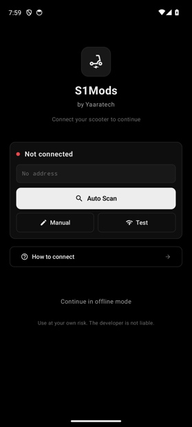
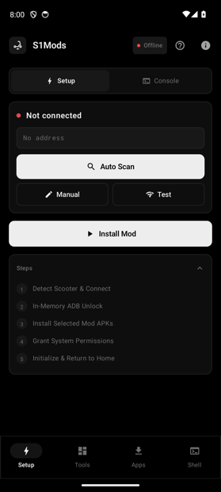
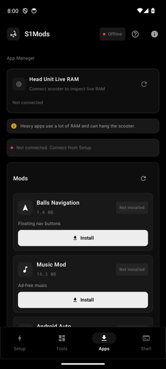
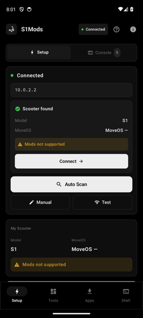
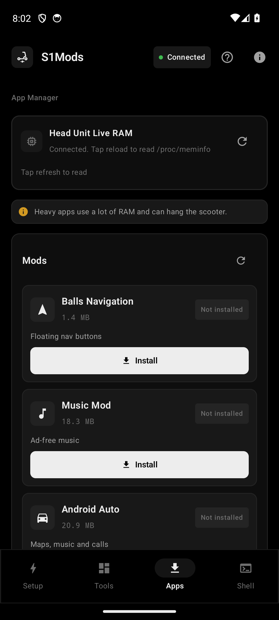
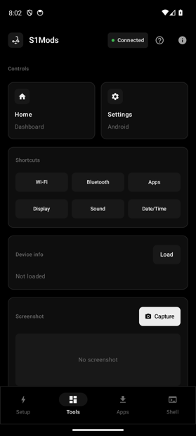

# The S1Mods ecosystem

A complete, open-source toolkit for modding an Ola S1 head unit (which runs Android under
Ola's MoveOS skin). Everything here is built from source and rebrandable; see
[`SAFETY.md`](SAFETY.md) for the non-destructive / OTA-safe design and
[`BUILD.md`](BUILD.md) for building it yourself.

## What's in the box

| Piece | What it is | Where |
| --- | --- | --- |
| **S1Mods app** (`com.yaaratech.s1mods`) | Zero-PC Android companion app: discover the scooter, unlock ADB, install mods, grant permissions, inspect the head unit, run a root shell | `android/` |
| **PC installer** (`setup.py`) | Same flow from a computer over Wi-Fi; `--uninstall` and `--revert` included | repo root |
| **`ola.py`** | Low-level CLI for the head unit's root gRPC channel (TCP 50005) | repo root |
| **Balls** (`com.yaaratech.ball`) | Floating Back/Home/Settings nav overlay — fork of QuickBall (GPL-3.0) | `mods/balls` |
| **Music Mod** (`com.yaaratech.musicmod`) | Ad-free music client (Rust/librespot core) — fork of Square (GPL-3.0) | `mods/music` |
| **Android Auto** (`com.yaaratech.androidauto`) | Wireless Android Auto receiver — fork of open-headunit (AGPL-3.0) | `mods/androidauto` |
| **OpenPlay** (`com.yaaratech.openplay`) | CarPlay-compatible projection receiver — fork of DiPlay (GPL-3.0) | `mods/openplay` |

## How it connects

```
   Phone (S1Mods app)  ──Wi-Fi / hotspot──►  Ola S1 head unit (Android + MoveOS)
        │                                            │
        │  gRPC  wifican.WifiCanRpc  (TCP 50005)     │  runs commands as root (uid 0)
        │  ───────────────────────────────────────► │  pm / am / settings / getprop …
        │                                            │
        │  ADB over TCP (5555), unlocked via an      │  installs the mod APKs into /data
        └─ in-RAM key bind-mount (reverts on reboot) ┘
```

The scooter is, in effect, "an Android device at an IP address." The app finds it over
link-local IPv6, talks to its root gRPC daemon, briefly unlocks ADB **in RAM** (nothing is
flashed), installs the mod APKs, and grants each mod exactly the permissions it needs.

## The app in both states

The app works the same whether or not a scooter is reachable — it just gates the vehicle
actions behind a live connection. The status pill (top-right) and the per-card state make the
mode obvious.

### 🔴 Not connected (offline)

You can browse everything, read the steps, and prepare — but vehicle actions wait for a link.

| Connect screen | Setup (offline) | App Manager (offline) |
| --- | --- | --- |
|  |  |  |
| "Not connected", no address yet — **Auto Scan**, **Manual**, **Test**, or continue offline. | The pill reads **Offline**; the 5-step install flow (detect → unlock → install → grant → home) is shown but idle. | Live RAM reads "Not connected"; each mod shows its size and an **Install** button that waits for a connection. |

### 🟢 Connected

Once the handshake succeeds the pill turns **Connected** (green), the scooter is identified,
and every vehicle action lights up.

| Setup (connected) | App Manager (connected) | Toolbox (connected) |
| --- | --- | --- |
|  |  |  |
| **Scooter found** — model + MoveOS version, with a one-tap **Connect / install** path. | **Head Unit Live RAM** now reads `/proc/meminfo`; **Install** actions are live. | Controls (Home / Settings), quick shortcuts (Wi-Fi, Bluetooth, Display…), device info, and a one-tap display **screenshot**. |

> The connected screenshots above were produced against the project's own fake
> `wifican` test daemon (see [`SAFETY.md`](SAFETY.md) and `testsupport/`), so the whole flow
> is demonstrable with no scooter. A real head unit shows the same UI with real values.

## Mod health & management (v1.1.0)

The app's **Health** tab is the management center for everything already installed. It
reuses the same `ModRegistry` grant contract as setup — no new vehicle access — and adds:

| Feature | What it does |
| --- | --- |
| **Per-mod health** | For each mod: installed?, **installed version → latest shipped version**, and whether its **accessibility service** and **overlay/appops** are actually in effect (the grants that silently fall off). Reads `dumpsys package`, `settings get secure enabled_accessibility_services`, and `appops get`. |
| **Repair** | One tap re-applies a mod's full grant contract (app-ops → permissions → merge-safe accessibility). |
| **Install & grant / Remove** | Install a missing bundled mod, or symmetrically remove one (reverts grants first, refuses MoveOS/system packages). |
| **Profiles** | One-tap bundles — **Minimal** (nav), **Commute** (nav + Android Auto), **Media** (nav + music), **Everything** — run through the normal install + grant flow. |
| **Backup & restore** | Snapshots installed mods + versions + the persistent `scootermode` to JSON in app storage; restore reinstalls + re-grants bundled mods after an OTA or reset. |
| **OTA-safe watchdog** | Compares the live state to the last backup; if a MoveOS update wiped mods, it flags them and offers a one-tap **Re-apply from backup**. |

**Connection resilience:** the app persists the last scooter (IP/scope) and silently
reconnects on launch, so Auto-Scan isn't needed every session.

> The `dumpsys` / `appops` / accessibility parsers were validated directly against a live
> Android device. The connected Health UI requires a reachable MoveOS gRPC endpoint
> (port 50005); offline, the tab shows a clear "Not connected" prompt.

## Install / uninstall, safely

- **Install:** verify APK SHA-256 → `pm install` → grant app-ops / permissions / accessibility
  (merge-safe) → launch. See [`INSTALL_UNINSTALL.md`](INSTALL_UNINSTALL.md).
- **Uninstall:** the exact inverse — stop, revert grants, clean accessibility, then remove.
  The tool **refuses to touch MoveOS / system packages**.
- **Restore for OTA / handover:** `python setup.py --revert` puts MoveOS back to its captured
  stock state; a reboot clears the in-RAM ADB key. Nothing persistent is left behind.

## Build & verify

Every component builds from source and is covered by a device-free test suite
(`pytest`, 23 tests) plus CI. See [`BUILD.md`](BUILD.md) for the per-fork toolchain matrix and
[`../.github/workflows/`](../.github/workflows) for the build/sign/release pipeline.
